<p align="center">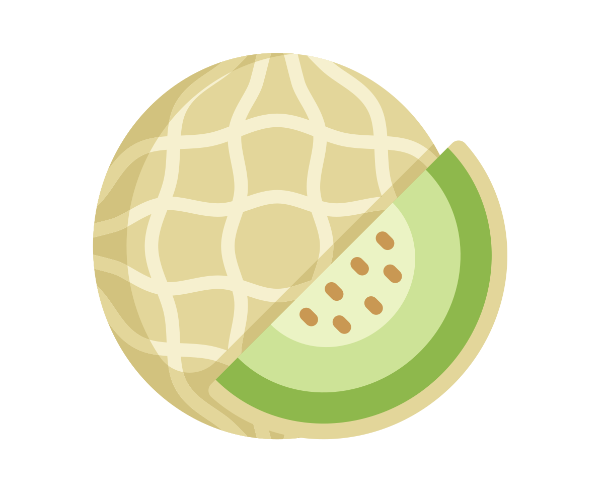</p>
<h1 align="center">Honeydew</h1>
<p align="center">A free, open-source music studio modelled on FL Studio Mobile, written in Rust.</p>
<p align="center">Runs on Windows, Linux, macOS, Android and in the browser.</p>

<p align="center">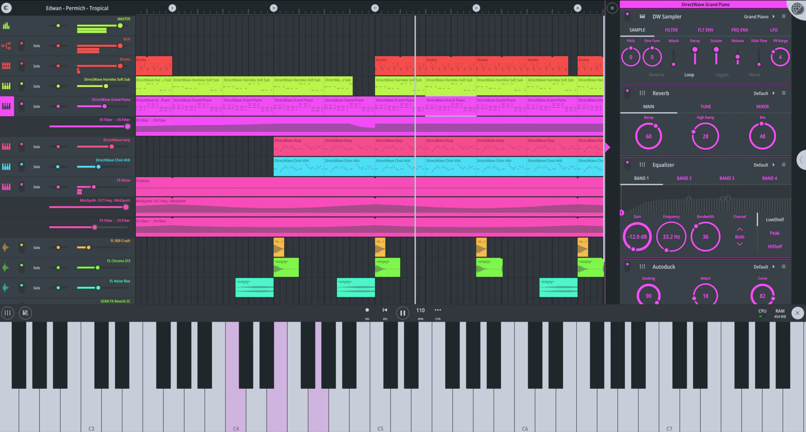</p>
<p align="center">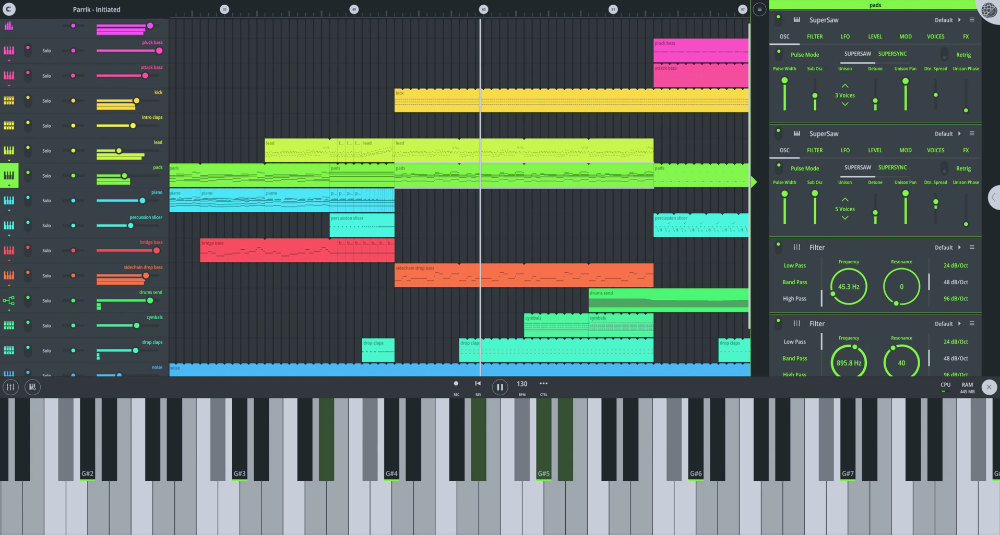</p>

---

## Screens

FL Studio Mobile demo projects, opened as `.flm` files.

<table>
  <tr>
    <td width="50%">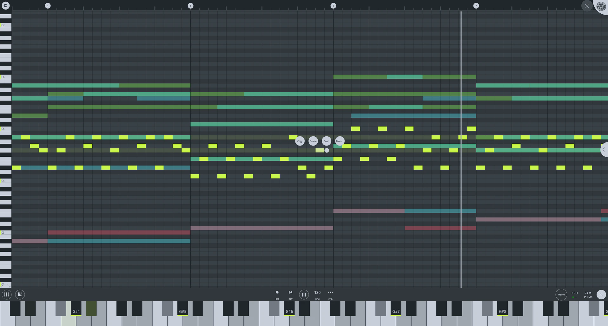<br><b>Piano roll</b>: Parrik - Initiated</td>
    <td width="50%">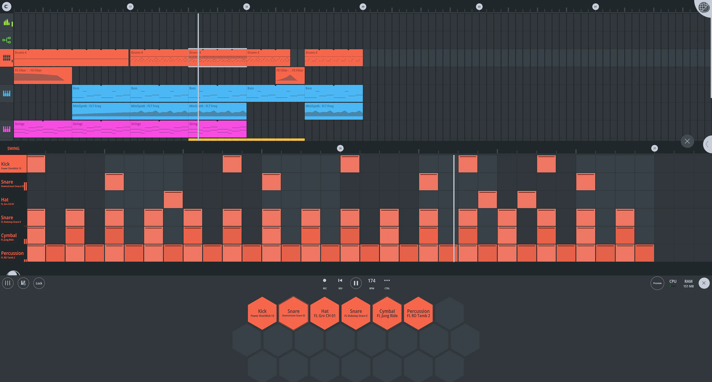<br><b>Drums</b>: Nucleon - Shogun</td>
  </tr>
  <tr>
    <td>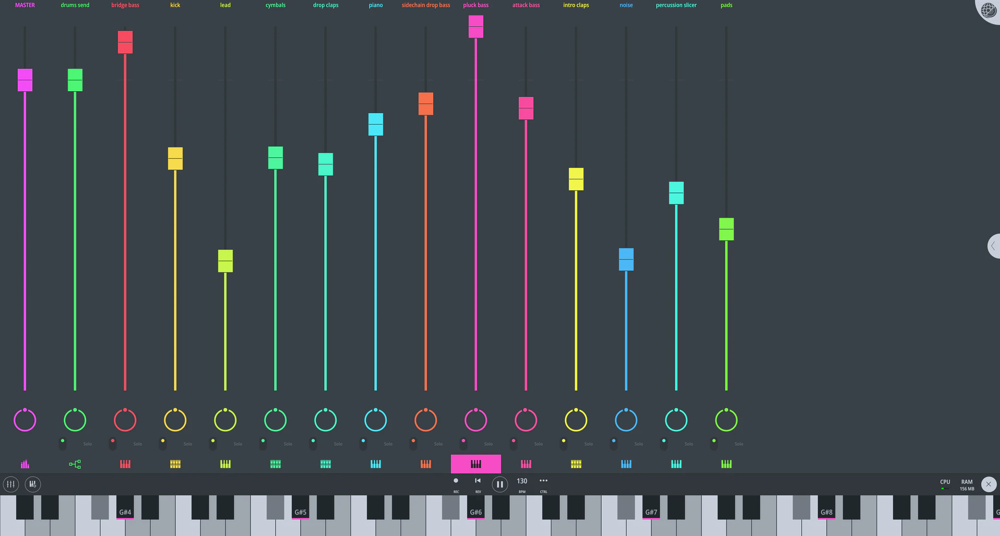<br><b>Mixer</b>: Parrik - Initiated</td>
    <td>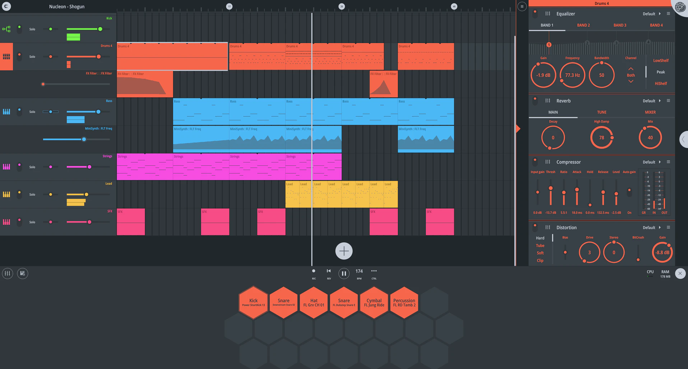<br><b>Effects rack</b>: Nucleon - Shogun</td>
  </tr>
  <tr>
    <td>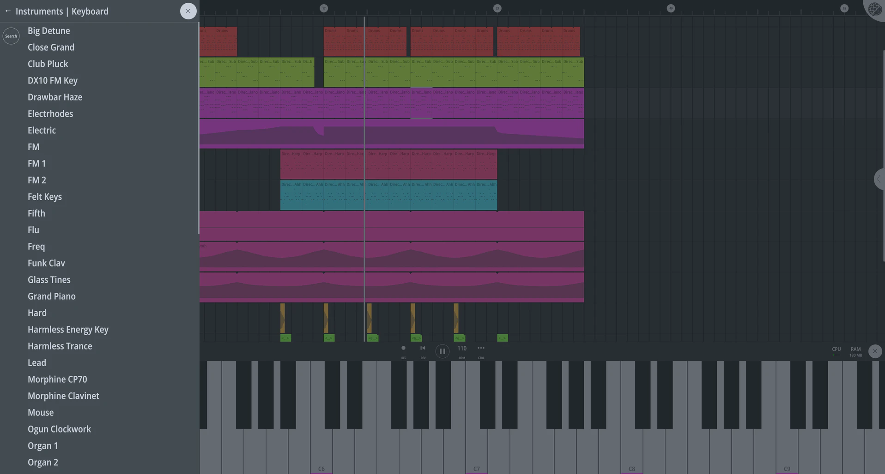<br><b>Instrument picker</b>: Edwan - Permich - Tropical</td>
    <td>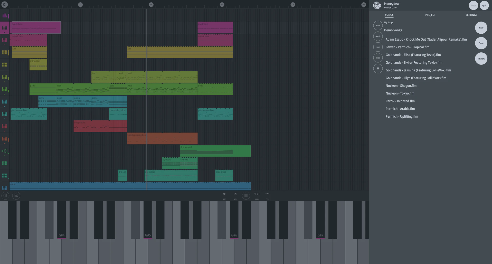<br><b>Songs menu</b>: the demo songs, over Parrik - Initiated</td>
  </tr>
  <tr>
    <td>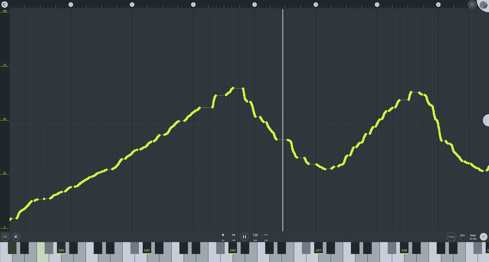<br><b>Automation</b>: Parrik - Initiated</td>
    <td>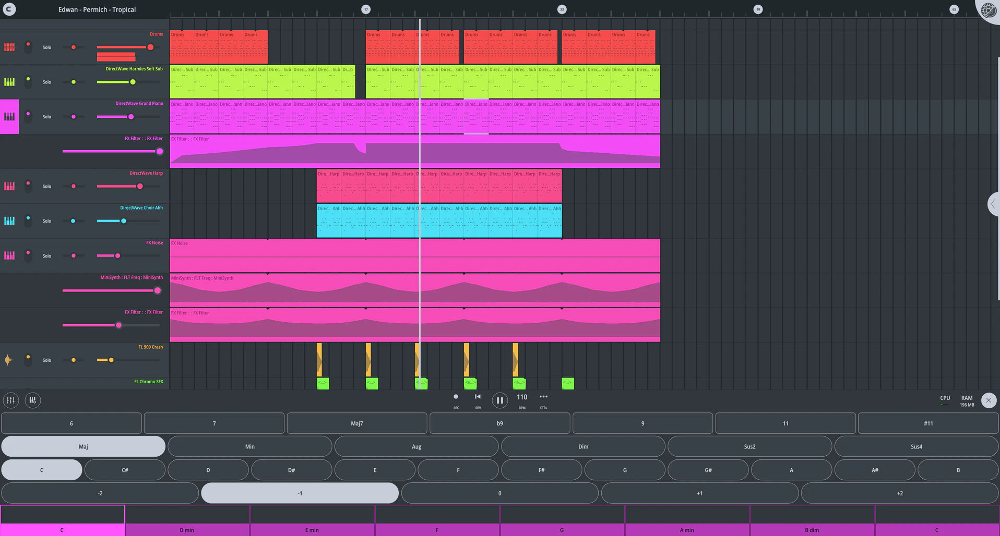<br><b>Chord editor</b>: Edwan - Permich - Tropical</td>
  </tr>
  <tr>
    <td colspan="2" align="center">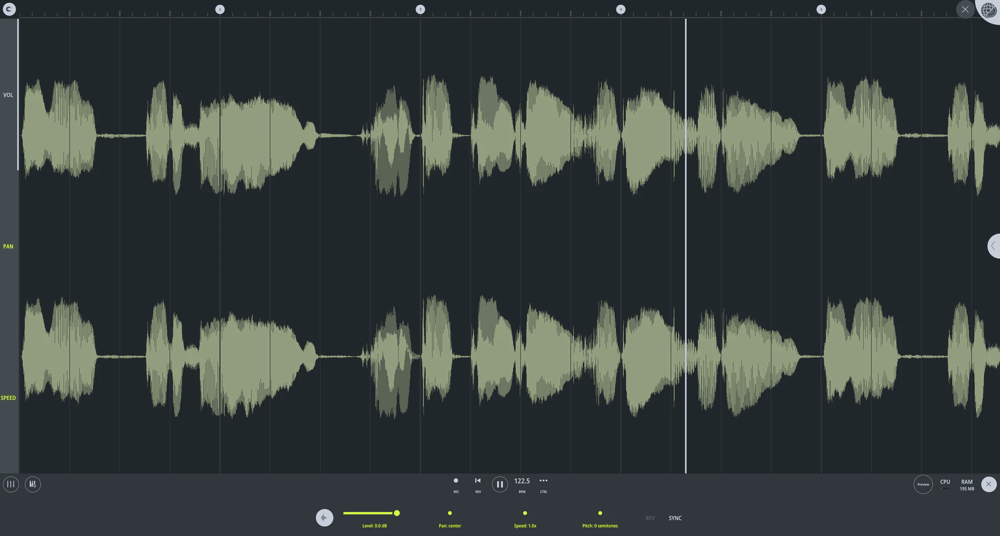<br><b>Audio editor</b>: Goldhands - Elisa (Featuring Tevlo)</td>
  </tr>
</table>

---

## Download

Get the latest build from [Releases](https://github.com/daijro/honeydew/releases/latest).

| Platform | Download |
|---|---|
| Windows | `windows-x86_64.zip`, or `windows-arm64.zip` for ARM |
| macOS | `macos-arm64.tar.gz` (Apple Silicon only) |
| Linux | `linux-x86_64.AppImage` or `.tar.gz`, also for `aarch64` |
| Alpine and other musl distros | `linux-x86_64-musl.tar.gz` or `linux-aarch64-musl.tar.gz` |
| FreeBSD | `freebsd-x86_64.tar.gz` |
| Android | `-arm-base.apk`, which downloads its sounds, or `-arm.apk` with them inside (64-bit or 32-bit ARM, Android 8 or later) |
| iOS (experimental) | `honeydew-ios-<version>.ipa` (iOS 14 or later). It's unsigned: install it with AltStore, SideStore or Sideloadly using your own Apple ID |
| Web | `honeydew-web-<version>.zip`, a static site you can host anywhere |

Extract the archive and run `honeydew-native`. The AppImage is a single file. Run `chmod +x` on it, then start it (add `--appimage-extract-and-run` if your system has no FUSE).

- `-avx2` builds can be faster on CPUs from 2013 onward. If unsure, take the plain one.
- `-no-sounds` builds are just the app, 10 to 15 MB. Honeydew keeps its sounds in its own data folder: a full build puts them there, and without one Honeydew offers to download them (or install `honeydew-<version>-sounds.zip` from Settings > Install sound library). Later updates can be the small download. On iOS, `-no-sounds.ipa` simply leaves the built-in sounds out.
- **Updates:** Main menu > UPDATES shows whether there's a newer version and what's new in it, and installs it on Android or downloads it on the desktop (an AppImage replaces itself). Honeydew checks at most every 6 hours, unless you turn off `Check for updates automatically`. The web version is always current.
- **Sounds:** the sound library has its own version and its own release (`sounds-<version>`). The base APK and `-no-sounds` builds download it once, about 740 MB (on Android over Wi-Fi unless you allow mobile data in UPDATES), and after that only the packs that changed, so an update that doesn't change the sounds downloads none. UPDATES shows the installed sound library and offers a newer one on its own, whatever build you started from; updating from the full APK to the base one keeps the sounds it had.
- Linux builds need glibc 2.35 or newer (Ubuntu 22.04, Debian 12). Alpine needs `apk add libstdc++ alsa-lib`. FreeBSD needs `pkg install alsa-lib alsa-plugins` and has no MIDI input yet.
- Your songs, samples and exports go in `Documents/Honeydew`. Settings > Open user folder takes you there.

---

## Opening and saving projects

Open a file from SONGS → Import, with `Ctrl+O`, or by dropping it on the window. Audio files dropped on the playlist become clips.

On the desktop and Android, SONGS → Import → Import folder copies a whole folder in, as importing a `.zip` of it would: samples go to My Samples, SoundFonts to My SoundFonts and so on, keeping the folder and its subfolders.

| Format | Open | Save |
|---|---|---|
| FL Studio Mobile songs (`.flm`) and project archives (`.zip`) | Yes | Yes |
| MIDI (`.mid`, `.midi`) | Yes | Yes |
| FL Studio projects (`.flp`, or a `.zip` with its samples) | Yes | Yes, as a `.zip` |
| Audio (WAV, FLAC, OGG, MP3) | No | Yes |

- **MIDI:** each channel gets the closest bundled instrument for its General MIDI program. Channel 10 becomes a drum kit.
- **Opening an FLP:** you get the channels, patterns, playlist, audio clips, tempo, volume and pan. 3x Osc channels keep their sound, and Fruity Reeverb 2 and Fruity Limiter become Lemon Reverb and Lemon Limiter with their settings. Missing plugins and samples play the closest bundled sound, and a summary lists what was swapped. `Locate samples...` finds missing samples in a folder you pick.
- **Saving an FLP:** samples are included, and each channel's effects become FL Studio's own effects on its mixer insert (Lemon Reverb and Lemon Limiter with their settings). Turn on `Include rendered audio` to also add each channel as audio, so the project sounds the same in FL Studio.

---

## Plugins

The desktop app can use VST3, VST2 and CLAP plugins as instruments and effects.

<p align="center">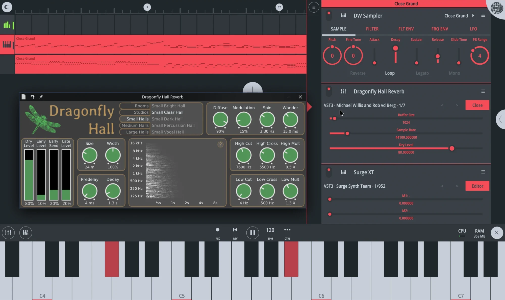</p>

1. Install your plugins in one of the folders below.
2. Open a channel's **Modules** browser. Plugins are listed under PLUGIN INSTRUMENTS and PLUGIN EFFECTS.
3. Adding a plugin opens its window. The pop-out button on its card opens it again.

Plugin settings are saved with the project, and their controls can be automated.

**Built-in plugins, on every platform:** Lemon Studio's Lemon Trio and Lemon Sampler are under SYNTH, and Lemon Parametric EQ under FILTER. Their own controls show right in the rack card, on the web and Android too. If you have them installed separately, Honeydew uses the built-in ones. On the web, Lemon Sampler's time stretching only resamples.

**Built-in effects:** Lemon Studio's small effects (Lemon Soft Clipper, Fast Distortion, Balance, Stereo Enhancer, Transient Processor, Chorus, Stereo Shaper, Filter, Flanger and Phaser), Lemon Delay, Lemon Vocoder, the multiband maximiser Press and the pattern filter Pulp Filter, in their sections of the Modules browser. Pulp Filter's patterns follow the song's tempo and position. Lemon Vocoder's carrier is the channel its card's `Sidechain` menu picks.
**Controllers:** Lemon Peak Controller (a peak follower and LFO) and Lemon Formula Controller (a formula over time and its knobs), under MISC, make no sound of their own: their output drives a param of the song. Touch the param to drive (any automatable control, on any channel), then pick `Link recent control` in the controller card's ≡ menu; `Clear target` unlinks it. While the song plays the param follows the output, smoothed, and its control shows it. The link is saved with the song.

**Tesla**, Lemon Studio's audio editor and recorder, is under MISC: put it on a channel's rack to record what reaches it, then edit the take in its card. On Android and the web its `Save sample as` goes to the user folder's My Recordings. Sending a sample to the playlist, a channel or a new Lemon Slicer channel works only in Lemon Studio. On the web its time stretch and pitch shift only resample.

Also under SYNTH: Citrus, a six-operator FM synth; Lemon Drum Sampler, with 32 pads (bank A on the General MIDI drum keys, pad 1 on C#3; bank B from C5 up); and Lemon Slicer, which cuts a loop into slices that play from C5 up, listed just below Honeydew's own Slicer. On Android and the web their Load buttons open Honeydew's sample picker. Put them on an Instrument channel and play the pads or slices from the piano roll.

**Where Honeydew looks:**

- **Linux:** `~/.vst3`, `~/.vst` and `~/.clap`, the same folders under `/usr/lib` and `/usr/local/lib`, and `VST_PATH` / `CLAP_PATH`.
- **Windows and macOS:** the standard plugin folders.
- **Your own folders:** add them in SETTINGS → Plugins. `Rescan` picks up new plugins.

**Windows plugins on Linux:** install [yabridge](https://github.com/robbert-vdh/yabridge) or [vstbridge](https://github.com/rations/vstbridge) with Wine. They put bridged copies in `~/.vst3/yabridge` and `~/.vst/yabridge`, which Honeydew already scans.

**Notes:**

- External plugin editor windows open on Linux, Windows and macOS. If a plugin cannot create its native editor, use the sliders on the plugin's card.
- FL Studio Mobile will still opens projects that use plugins, just without the plugins. The web and Android versions keep other plugins' settings but don't play them.
- Opening an FLP loads its plugins if you have them installed, and saving as FLP writes them back.

### Local music-assistant control (experimental)

The desktop build has an opt-in local control bridge for editing the open song
with an MCP assistant. It can reuse an already-configured plugin instrument
without changing its preset, or create a built-in synth/drum track and add
notes. See [the MCP setup guide](tools/honeydew-mcp/README.md) for security,
configuration, commands and current limits.

**Multi core processing:** On Linux, macOS and Windows desktop builds, SETTINGS → Multi core processing can run independent channel racks on separate CPU cores. Sends still run before their target bus, and each rack's modules stay in order. The setting takes effect during playback without a restart. It is off by default and falls back to sequential processing for short segments, a single-core machine or a song with no independent channels. It does not split one plugin instance (including Vital) across cores; with one active instrument, leave it off. If enabling it increases underruns on your audio setup, turn it off again.

---

## Using your own FL Studio Mobile sounds

Honeydew doesn't include any FL Studio Mobile content. If you own the app, you can import its sounds, presets and demo songs from your own copy. They stay on your computer, aren't included in exported project ZIPs, and are still covered by your FL Studio Mobile licence, so don't share them.

1. Copy your app's `.apk` or `.obb` into the **Original Content** folder. SETTINGS has an `Open folder` button.

   | OS | Folder |
   |---|---|
   | Linux | `~/Documents/Honeydew/Original Content` |
   | macOS | `~/Documents/Honeydew/Original Content` |
   | Windows | `Documents\Honeydew\Original Content` |

2. Open SETTINGS and choose `Import`.

Or from the command line:

```sh
cargo run --release --bin honeydew-import -- path/to/your.apk
```

The sounds and presets then show up in the pickers, and demo songs that use them play correctly. The icons are always Honeydew's own. Each file is imported once; delete the hidden `.imported-…` file next to it to import it again. The web version can't import.

**Getting the files from your phone.** Use only your own copy. With USB debugging on and Android's platform tools installed:

```sh
adb shell pm list packages | grep -i studio   # find the package name
adb shell pm path <package>                   # find the APK (pull base.apk first if there are several)
adb pull <path>
adb pull /sdcard/Android/obb/<package>/       # the OBB, if the app has one
```

---

## Building from source

### Desktop

```sh
cargo run --release
```

**Linux desktop icon:** Wayland only shows an app's icon if a desktop entry is installed. Run `tools/install-desktop-entry.sh` after `cargo build --release` (add `--uninstall` to remove it). Run it again if you move the repository.

### Sound library

The sound library lives in `sounds/`, split into 90 MB parts to stay under GitHub's file size limit. To rebuild it from the raw sources in `../content-sources` (or `$HONEYDEW_SOURCES`):

```sh
tools/release-content.sh 0.5.4
```

Commit the updated `sounds/honeydew-sounds.zip.*` parts and `sounds/release.txt` (the library's version: the app updates an installed library that is older) with your changes. Add `--web` to also build the web ZIP. Tagged releases include the sounds automatically, and the first release with a new library version also publishes it as its own release, `sounds-<version>`, which the apps download from. Give every changed library a new version.

### Web

For development:

```sh
rustup target add wasm32-unknown-unknown
cargo install trunk
trunk serve
```

To test with the bundled sounds, also run `python3 -m http.server 8081 --bind 127.0.0.1 --directory content-out`.

For a release build:

```sh
tools/web-dist.sh          # build the site into dist/
tools/web-dist.sh --check  # check an existing build
tools/web-dist.sh --zip    # also write target/honeydew-web-<version>.zip
```

- **Requirements:** Trunk, binaryen's `wasm-opt` (or set `WASM_OPT`) and `unzip`.
- **Hosting:** serve `dist/`. Example configs for nginx, Caddy and Cloudflare are in `deploy/`.
- **Browsers:** Chrome 96, Firefox 113 or Safari 16.4 and later. Older browsers see a notice.
- **Compression:** files are pre-gzipped and none is over 25 MiB. Hosts that don't send `Content-Encoding: gzip`, like Cloudflare, still work: the browser unpacks the files itself.
- **Shortcuts:** in the browser, Honeydew's shortcuts win over the browser's, except Ctrl+C, V and X. Chrome keeps Ctrl+Shift+T.

### Android

The Android version plays, saves and exports songs into its Honeydew folder, which also shows in the Files app, so you can copy songs, renders and samples in and out there. SONGS → Import opens a song, archive, MIDI or FLP file from anywhere the system picker reaches, like Downloads or an SD card, and Import folder copies a whole sound folder in. Recording asks for the microphone the first time. A wired or USB headset's mic is used while it's plugged in, and Settings → Audio input picks another one, like a USB audio interface. You hear yourself (input monitoring) only in headphones, never through the phone's speaker. A call or leaving the app stops a recording and keeps what was recorded. MIDI devices aren't supported yet, and uninstalling the app deletes the Honeydew folder with your songs.

You need Java 21, Android SDK platform 36, Build Tools 36.0.0, NDK 28.0.13004108, Python 3 and `unzip`. Set `ANDROID_HOME` to your SDK, then:

```sh
rustup target add aarch64-linux-android armv7-linux-androideabi
cargo install cargo-ndk --version 4.1.2 --locked
tools/android-dist.sh
```

This writes `target/honeydew-android-<version>-arm-debug.apk`, one APK for 64-bit and 32-bit ARM. Add `--base` for the APK without sounds (`-arm-base-debug.apk`), which downloads them. The debug app is called Honeydew Debug and installs alongside the release app. Its signing key is kept in `android/debug.keystore`; keep that file so debug builds can update each other.

**Release signing:** use the same key for every release, or Android won't install updates over the old version. Back up the keystore and passwords outside the repository.

- **Local release:** set `ANDROID_KEYSTORE_FILE`, `ANDROID_KEYSTORE_PASSWORD`, `ANDROID_KEY_ALIAS` and `ANDROID_KEY_PASSWORD`, then run `tools/android-dist.sh --release`.
- **GitHub releases:** add the repository secrets `ANDROID_KEYSTORE_BASE64` (the keystore as base64), `ANDROID_KEYSTORE_PASSWORD`, `ANDROID_KEY_ALIAS` and `ANDROID_KEY_PASSWORD`. Without them the Android job fails rather than publishing an unsigned APK.

See Android's [app-signing guide](https://developer.android.com/studio/publish/app-signing) for creating a key.

### iOS

The iOS version is experimental. As on Android, your songs, renders and samples go in its Honeydew folder, which shows in the Files app under On My iPhone, and SONGS → Import and Import folder open the system's file picker. Recording asks for the microphone the first time. If you said no, the message has a button to the app's page in Settings. You hear yourself only in headphones, and a call or leaving the app stops a recording and keeps what was recorded. MIDI devices aren't supported yet, and there's no UPDATES tab: install a newer IPA the same way.

Build it on a Mac with Xcode:

```sh
rustup target add aarch64-apple-ios aarch64-apple-ios-sim
tools/ios-dist.sh
```

This writes `target/honeydew-ios-<version>.ipa` and `target/honeydew-ios-<version>-no-sounds.ipa`. `tools/ios-dist.sh --sim` builds the Simulator's app, and `tools/ios-selftest.sh target/ios-sim/Honeydew.app selftest` runs its self-test in the Simulator.

---

## About

Honeydew is a clean-room reimplementation. FL Studio Mobile's behaviour, file formats and look were written down as a specification, and Honeydew's code was written only from that. It contains no code, samples, presets or artwork from FL Studio Mobile. The icons are Honeydew's own as well: every one is drawn from scratch in code, not taken from the app.

Honeydew is an independent project, not affiliated with or endorsed by Image-Line. FL Studio is a trademark of Image-Line.

---

## License and credits

- **Code:** [GPL-3.0-or-later](LICENSE). Copyright (c) 2026 The Honeydew contributors.
- **Plugin hosting, FLP support, Lemon Reverb, Lemon Limiter, Lemon Trio, Lemon Sampler, Lemon Parametric EQ, Citrus, Lemon Drum Sampler and Lemon Slicer:** from Lemon Studio by ItsAlphaNeon; see [Code from Lemon Studio](#code-from-lemon-studio) below.
- **Lemon Studio's small effects, Lemon Delay, Lemon Vocoder, Press and Pulp Filter:** from Lemon Studio by ItsAlphaNeon too.
- **Font:** Open Sans SemiCondensed SemiBold, SIL Open Font License 1.1 ([`assets/fonts/OFL.txt`](assets/fonts/OFL.txt)).
- **Icon:** a derivative of "Melon" by afitrose, licensed as Free for commercial use WITH ATTRIBUTION.
- **Sounds:** the bundled instruments, drum kits, one-shots, effects, loops and waveforms come from the sources below. Full notices are in the app under SETTINGS → Sound credits.

<details>
<summary>See all sources</summary>

| Source | Author | Licence |
|---|---|---|
| [Adventure Kid Waveforms (AKWF-FREE)](https://github.com/KristofferKarlAxelEkstrand/AKWF-FREE) | Kristoffer Ekstrand (Adventure Kid) | CC0 |
| [Greg Sullivan’s E-Pianos](https://github.com/sfzinstruments/GregSullivan.E-Pianos) | Greg Sullivan; SFZ mapping by kinwie | [CC BY 3.0](https://creativecommons.org/licenses/by/3.0/) |
| [FreePats Church Organ Emulation](https://freepats.zenvoid.org/Organ/pipe-organ.html) | Roberto (FreePats) | CC0 |
| [FreePats Concert Harp](https://freepats.zenvoid.org/OrchestralStrings/harp.html) | Versilian Studios samples, assembled by Roberto (FreePats) | CC0 |
| [FreePats Electric Organ Emulations](https://freepats.zenvoid.org/Organ/electric-organ.html) | Roberto (FreePats); Strix SoundFont Team (percussive, rock) | CC0 |
| [FreePats FM Pianos](https://freepats.zenvoid.org/ElectricPiano/synthesized-piano.html) | FreePats project and contributors | CC0 |
| [FreePats FSBS Clean Guitars](https://freepats.zenvoid.org/ElectricGuitar/clean-electric-guitar.html) | FreePats project and contributors | CC0 |
| [FreePats Old Piano FB](https://freepats.zenvoid.org/Piano/honky-tonk-piano.html) | FreePats project and contributors | CC0 |
| [FreePats Spanish Classical Guitar](https://freepats.zenvoid.org/Guitar/acoustic-guitar.html) | Roberto (FreePats) | CC0 |
| [FreePats Synth Bass](https://freepats.zenvoid.org/Synthesizer/synth-bass.html) | FreePats project and contributors | CC0 |
| [FreePats Synth Lead](https://freepats.zenvoid.org/Synthesizer/synth-lead.html) | FreePats project and contributors | CC0 |
| [FreePats Synth Pad](https://freepats.zenvoid.org/Synthesizer/synth-pad.html) | FreePats project and contributors | CC0 |
| [FreePats Upright Piano KW](https://freepats.zenvoid.org/Piano/acoustic-grand-piano.html) | Gonzalo and Roberto (FreePats) | CC0 |
| [Big Rusty Drums](https://github.com/sfzinstruments/karoryfer.big-rusty-drums) | Karoryfer Samples | CC0 |
| [Black and Green Guitars](https://shop.karoryfer.com/pages/free-black-and-green-guitars) | Karoryfer Samples | CC0 |
| [Bigcat Cello](https://github.com/sfzinstruments/karoryfer-bigcat.cello) | Karoryfer Lecolds x bigcat instruments (cellist Kamila Borowiak) | CC0 |
| [Body Percussion](https://github.com/sfzinstruments/body_percussion) | Karoryfer Samples | CC0 |
| [Caveman Cosmonaut](https://github.com/sfzinstruments/karoryfer.caveman-cosmonaut) | Karoryfer Samples | CC0 |
| [Emilyguitar](https://shop.karoryfer.com/pages/free-emilyguitar) | Karoryfer Samples | CC0 |
| [Frankensnare](https://github.com/sfzinstruments/karoryfer.frankensnare) | Karoryfer Samples | CC0 |
| [Growlybass](https://github.com/sfzinstruments/karoryfer.growlybass) | Karoryfer Samples | CC0 |
| [The Hat With The Phat](https://github.com/sfzinstruments/Karoryfer.TheHatWithThePhat) | Karoryfer Samples | CC0 |
| [Meatbass](https://github.com/sfzinstruments/karoryfer.meatbass) | Karoryfer Samples | CC0 |
| [Shinyguitar](https://shop.karoryfer.com/pages/free-shinyguitar) | Karoryfer Samples | CC0 |
| [Sneakybass](https://shop.karoryfer.com/pages/free-sneakybass) | Karoryfer Samples | CC0 |
| [String Cyborgs](https://shop.karoryfer.com/pages/free-string-cyborgs) | Karoryfer Samples | CC0 |
| [Swirly Drums](https://github.com/sfzinstruments/karoryfer.swirly-drums) | Karoryfer Samples | CC0 |
| [Unruly Drums](https://github.com/sfzinstruments/karoryfer.unruly-drums) | Karoryfer Samples | CC0 |
| [War Tuba](https://github.com/sfzinstruments/karoryfer.war-tuba) | Karoryfer Samples | CC0 |
| [Digital Audio](https://kenney.nl/assets/digital-audio) | Kenney (kenney.nl) | CC0 |
| [Impact Sounds](https://kenney.nl/assets/impact-sounds) | Kenney (kenney.nl) | CC0 |
| [Interface Sounds](https://kenney.nl/assets/interface-sounds) | Kenney (kenney.nl) | CC0 |
| [RPG Audio](https://kenney.nl/assets/rpg-audio) | Kenney (kenney.nl) | CC0 |
| [Sci-fi Sounds](https://kenney.nl/assets/sci-fi-sounds) | Kenney (kenney.nl) | CC0 |
| [Meta Piano, Steel Guitar and Nylon Guitar](https://github.com/facebookincubator/Meta-open-sound) | Meta Creative Audio, Meta Platforms, Inc. | CC0 |
| [MuseScore_General](https://ftp.osuosl.org/pub/musescore/soundfont/MuseScore_General/) | S. Christian Collins; FluidR3 by Frank Wen; FluidR3Mono by Michael Cowgill; MuseScore | MIT |
| [512 Sound Effects (8-bit style)](https://opengameart.org/content/512-sound-effects-8-bit-style) | SubspaceAudio (Juhani Junkala) | CC0 |
| [Osiris Piano](https://shop.karoryfer.com/pages/free-osiris-piano) | Karoryfer Samples x Versilian Studios | CC0 |
| [Salamander Grand Piano V3](https://archive.org/details/SalamanderGrandPianoV3) | Alexander Holm | Public domain declaration |
| [Splendid Grand Piano](https://github.com/sfzinstruments/SplendidGrandPiano) | AKAI Professional (samples); SFZ by sfzinstruments | Public domain declaration |
| [University of Iowa Musical Instrument Samples](https://theremin.music.uiowa.edu/MIS.html) | Lawrence Fritts and the University of Iowa Electronic Music Studios | Unrestricted use; notice included |
| [Versilian Community Sample Library](https://github.com/sgossner/VCSL) | Versilian Studios LLC (Sam Gossner) | CC0 |
| [Virtuosity Drums](https://github.com/sfzinstruments/virtuosity_drums) | Versilian Studios x Karoryfer Samples (drummer Austin McMahon) | CC0 |
| [VSCO 2 Community Edition](https://github.com/sgossner/VSCO-2-CE) | Versilian Studios LLC (Sam Gossner) | CC0 |
| Honeydew procedural sounds | The Honeydew contributors | CC0 |

</details>

### Code from Lemon Studio

Honeydew brings FL Studio desktop features like plugins and flp file support into the app by including code from [Lemon Studio](https://github.com/ItsAlphaNeon/Lemon-Studio) by ItsAlphaNeon, used under the
GPL-3.0-or-later. Each file keeps its original copyright and license header, and the changes are listed in
[`THIRD_PARTY_NOTICES.md`](THIRD_PARTY_NOTICES.md).

<details>

<summary>See list of features</summary>

- **Plugin hosts** (`vendor/lemon-studio/`): the VST3, VST2 and CLAP hosts (`os-host`, `os-vst3`, `os-vst2`, `os-clap`)
  and the parts of `os-engine` they use.
- **FLP files** (`src/flp/`): the FL Studio project reader and writer, the mixer writer and the plugin wrapper format,
  from `os-flp`.
- **Plugin scanning and editor windows** (`src/plugins/scan.rs`, `src/plugins/window.rs`).
- **Lemon Reverb and Lemon Limiter** (`vendor/lemon-studio/os-engine/src/effects/`): Lemon Studio's reverb and its
  limiter, compressor and noise gate, as built-in effects.
- **Lemon Trio** (`vendor/lemon-studio/lemon-3x-osc/`): Lemon Studio's three-oscillator synth, built in with its own
  editor.
- **Lemon Sampler** (`vendor/lemon-studio/lemon-sampler/`): Lemon Studio's sampler, built in with its own editor.
- **Lemon Parametric EQ** (`vendor/lemon-studio/lemon-parametric-eq-2/`): Lemon Studio's seven-band EQ, built in with its
  own editor.
- **Lemon Studio's small effects, Lemon Delay, Lemon Vocoder, Press and Pulp Filter** (`vendor/lemon-studio/lemon-small-fx/`,
  its ten plugins' folders, `lemon-delay/`, `lemon-vocoder/`, `press/`, `pulp-filter/`): built in with their own editors.
- **Lemon Peak Controller and Lemon Formula Controller** (`vendor/lemon-studio/lemon-peak-controller/`,
  `lemon-formula-controller/`, with `lemon-small-fx/`): Lemon Studio's controllers, built in with their own editors.
- **Tesla** (`vendor/lemon-studio/tesla/`): Lemon Studio's audio editor and recorder, built in with its own editor.
- **Plugin UI and support code** (`vendor/lemon-studio/`): the editor kit, theme, drawing and fonts these three plugins use
  (`os-plugkit`, `os-ui`, `os-theme`), the host link and data model (`os-hostlink`, `os-model`), and the DSP and path
  helpers (`os-dsp`, `os-paths`).

</details>
