<p align="center">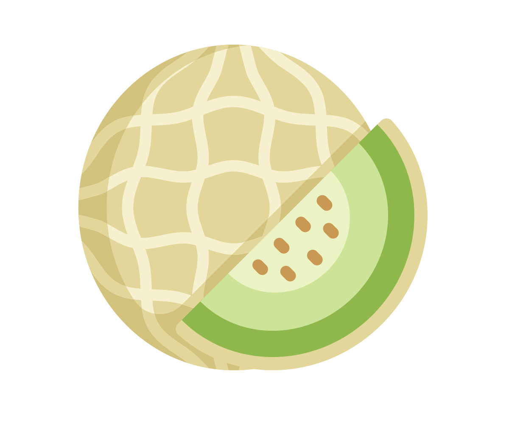</p>
<h1 align="center">Honeydew</h1>
<p align="center">A free, open-source music studio modelled on FL Studio Mobile, written in Rust.</p>
<p align="center">Runs on Windows, Linux, macOS, Android and in the browser.</p>

<p align="center">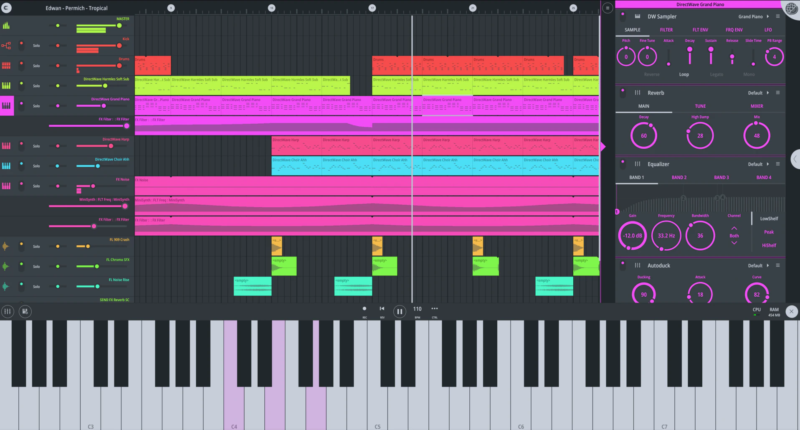</p>
<p align="center">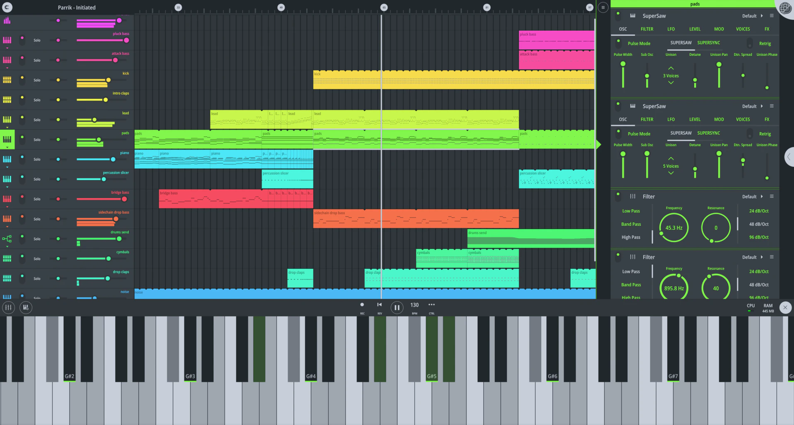</p>

## Download

Get the latest version from [Releases](https://github.com/daijro/honeydew/releases/latest).

- **Windows, Linux, macOS:** extract the archive and run `honeydew-native`. Keep the `content/` folder next to it: it holds the sound library.
- **Android:** install the `.apk`. Needs a 64-bit ARM device on Android 8 or later.
- **Web:** the `honeydew-web` ZIP is a static site. Serve the folder with any web server.

Every download includes the full sound library.

## Screens

FL Studio Mobile demo projects, opened as `.flm` files.

<table>
  <tr>
    <td width="50%">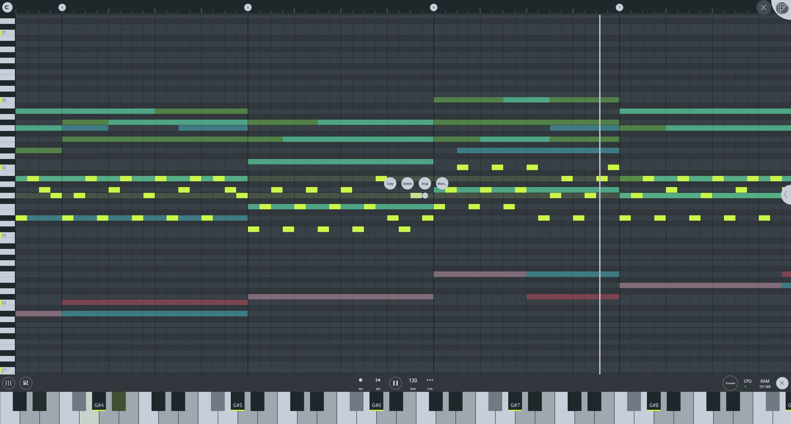<br><b>Piano roll</b>: Parrik - Initiated</td>
    <td width="50%">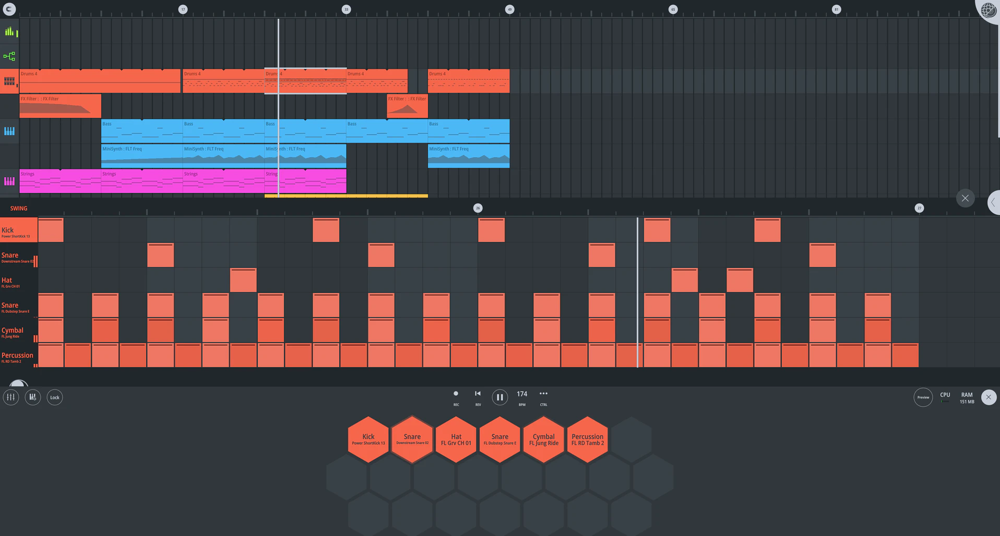<br><b>Drums</b>: Nucleon - Shogun</td>
  </tr>
  <tr>
    <td>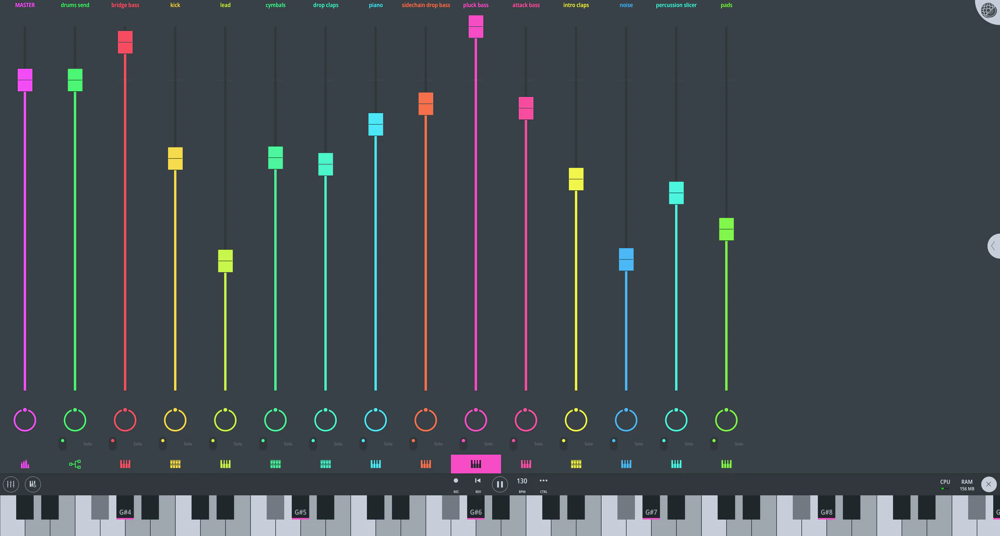<br><b>Mixer</b>: Parrik - Initiated</td>
    <td>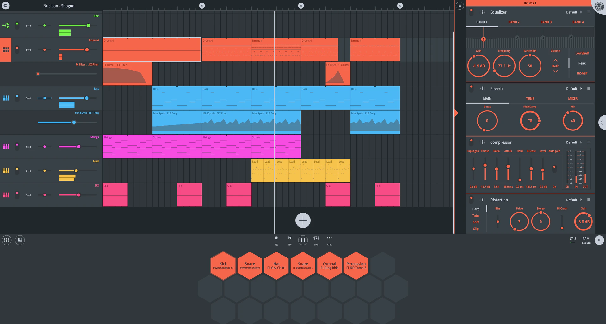<br><b>Effects rack</b>: Nucleon - Shogun</td>
  </tr>
  <tr>
    <td>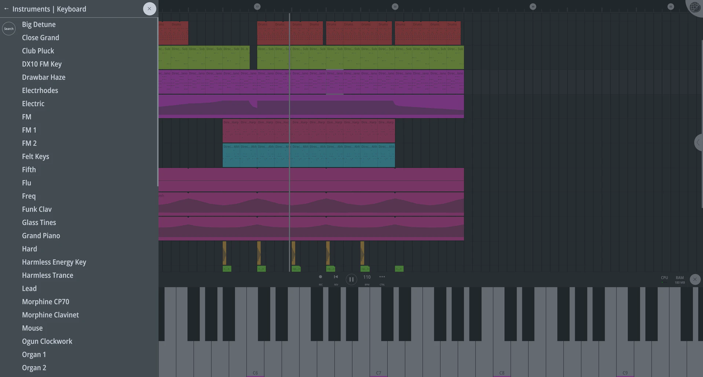<br><b>Instrument picker</b>: Edwan - Permich - Tropical</td>
    <td>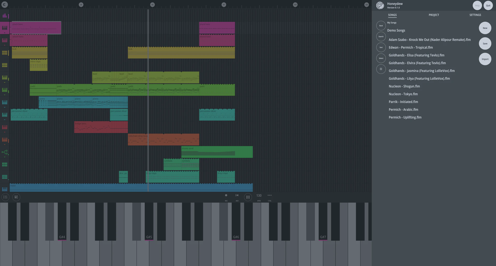<br><b>Songs menu</b>: the demo songs, over Parrik - Initiated</td>
  </tr>
  <tr>
    <td>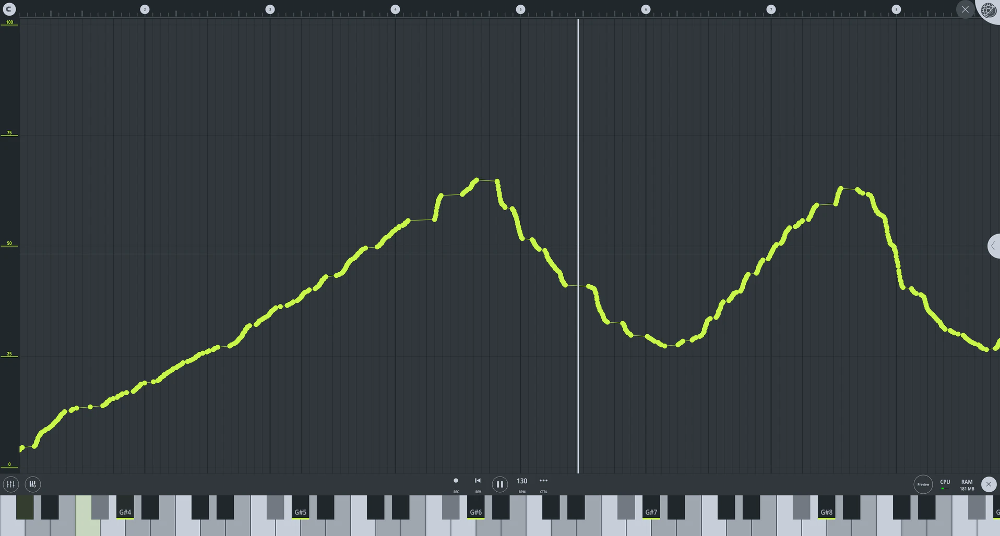<br><b>Automation</b>: Parrik - Initiated</td>
    <td>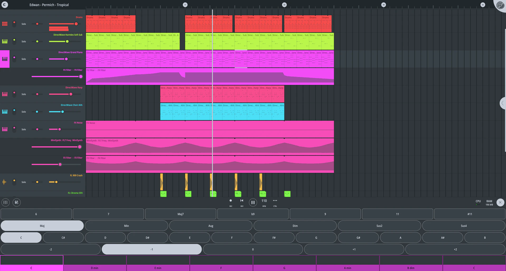<br><b>Chord editor</b>: Edwan - Permich - Tropical</td>
  </tr>
  <tr>
    <td colspan="2" align="center">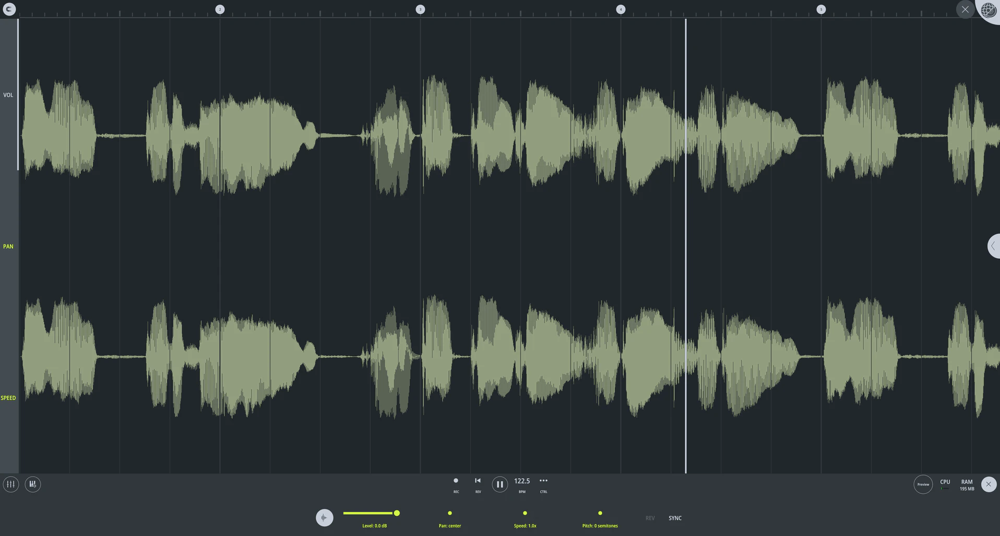<br><b>Audio editor</b>: Goldhands - Elisa (Featuring Tevlo)</td>
  </tr>
</table>

## Opening and saving projects

Open a file from SONGS → Import, with `Ctrl+O`, or by dropping it on the window.

| Format | Open | Save |
|---|---|---|
| FL Studio Mobile songs (`.flm`) and project archives (`.zip`) | Yes | Yes |
| MIDI (`.mid`, `.midi`) | Yes | Yes |
| FL Studio projects (`.flp`, or a `.zip` with its samples) | Yes | Yes, as a `.zip` |
| Audio (WAV, FLAC, OGG, MP3) | No | Yes |

- **MIDI:** each channel gets the closest bundled instrument for its General MIDI program. Channel 10 becomes a drum kit.
- **Opening an FLP:** you get the channels, patterns, playlist, audio clips, tempo, volume and pan. 3x Osc channels keep their sound. Missing plugins and samples play the closest bundled sound, and a summary lists what was swapped. `Locate samples...` finds missing samples in a folder you pick.
- **Saving an FLP:** samples are included, and each channel's effects become FL Studio's own effects on its mixer insert. Turn on `Include rendered audio` to also add each channel as audio, so the project sounds the same in FL Studio.

## Plugins (desktop only)

Honeydew can use VST3, VST2 and CLAP plugins as instruments and effects.

1. Install your plugins in one of the folders below.
2. Open a channel's **Modules** browser. Plugins are listed under PLUGIN INSTRUMENTS and PLUGIN EFFECTS.
3. Adding a plugin opens its window. The `Editor` button on its card opens and closes it again.

Plugin settings are saved with the project, and their controls can be automated.

**Where Honeydew looks:**

- **Linux:** `~/.vst3`, `~/.vst` and `~/.clap`, the same folders under `/usr/lib` and `/usr/local/lib`, and `VST_PATH` / `CLAP_PATH`.
- **Windows and macOS:** the standard plugin folders.
- **Your own folders:** add them in SETTINGS → Plugins. `Rescan` picks up new plugins.

**Windows plugins on Linux:** install [yabridge](https://github.com/robbert-vdh/yabridge) or [vstbridge](https://github.com/rations/vstbridge) with Wine. They put bridged copies in `~/.vst3/yabridge` and `~/.vst/yabridge`, which Honeydew already scans.

**Good to know:**

- Plugin windows open on Linux only for now. On Windows and macOS, use the sliders on the plugin's card.
- On Linux, a plugin that crashes while playing closes Honeydew. Scanning plugins is safe.
- Plugin latency is shown but not compensated.
- FL Studio Mobile still opens projects that use plugins, just without the plugins. The web and Android versions keep plugin settings but don't play them.
- Opening an FLP loads its plugins if you have them installed, and saving as FLP writes them back.

## Using your own FL Studio Mobile sounds

Honeydew doesn't include any FL Studio Mobile content. If you own the app, you can import its sounds and presets from your own copy. They stay on your computer, aren't included in exported project ZIPs, and are still covered by your FL Studio Mobile licence, so don't share them.

1. Copy your app's `.apk` or `.obb` into the **Original Content** folder. SETTINGS has an `Open folder` button.

   | OS | Folder |
   |---|---|
   | Linux | `~/.local/share/honeydew/Original Content` |
   | macOS | `~/Library/Application Support/Honeydew/Original Content` |
   | Windows | `%APPDATA%\Honeydew\data\Original Content` |

2. Open SETTINGS and choose `Import`.

Or from the command line:

```sh
cargo run --release --bin honeydew-import -- path/to/your.apk
```

The sounds and presets then show up in the pickers, and demo songs that use them play correctly. Each file is imported once; delete the hidden `.imported-…` file next to it to import it again. The web version can't import.

**Getting the files from your phone.** Use only your own copy. With USB debugging on and Android's platform tools installed:

```sh
adb shell pm list packages | grep -i studio   # find the package name
adb shell pm path <package>                    # find the APK (pull base.apk first if there are several)
adb pull <path>
adb pull /sdcard/Android/obb/<package>/        # the OBB, if the app has one
```

## Building from source

### Desktop

```sh
cargo run --release
```

**Linux desktop icon:** Wayland only shows an app's icon if a desktop entry is installed. Run `tools/install-desktop-entry.sh` after `cargo build --release` (add `--uninstall` to remove it). Run it again if you move the repository.

### Sound library

The sound library lives in `sounds/`, split into 90 MB parts to stay under GitHub's file size limit. To rebuild it from the raw sources in `../content-sources` (or `$HONEYDEW_SOURCES`):

```sh
tools/release-content.sh 0.2.1
```

Commit the updated `sounds/honeydew-sounds.zip.*` parts with your changes. Add `--web` to also build the web ZIP. Tagged releases include the sounds automatically.

### Web

For development:

```sh
rustup target add wasm32-unknown-unknown
cargo install trunk
trunk serve
```

To test with the bundled sounds, also run `python3 -m http.server 8081 --bind 127.0.0.1 --directory content-out`.

For a release build:

```sh
tools/web-dist.sh          # build the site into dist/
tools/web-dist.sh --check  # check an existing build
tools/web-dist.sh --zip    # also write target/honeydew-web-<version>.zip
```

- **Requirements:** Trunk, binaryen's `wasm-opt` (or set `WASM_OPT`) and `unzip`.
- **Hosting:** serve `dist/`. Example configs for nginx, Caddy and Cloudflare are in `deploy/`.
- **Browsers:** Chrome 96, Firefox 113 or Safari 16.4 and later. Older browsers see a notice.
- **Compression:** files are pre-gzipped and none is over 25 MiB. Hosts that don't send `Content-Encoding: gzip`, like Cloudflare, still work: the browser unpacks the files itself.
- **Shortcuts:** in the browser, Honeydew's shortcuts win over the browser's, except Ctrl+C, V and X. Chrome keeps Ctrl+Shift+T.

### Android

The Android version plays songs and saves them inside the app. Microphone recording, MIDI devices and importing or exporting files aren't supported yet, and uninstalling the app deletes its songs.

You need Java 21, Android SDK platform 36, Build Tools 36.0.0, NDK 28.0.13004108, Python 3 and `unzip`. Set `ANDROID_HOME` to your SDK, then:

```sh
rustup target add aarch64-linux-android
cargo install cargo-ndk --version 4.1.2 --locked
tools/android-dist.sh
```

This writes `target/honeydew-android-<version>-arm64-debug.apk`. The debug app is called Honeydew Debug and installs alongside the release app. Its signing key is kept in `android/debug.keystore`; keep that file so debug builds can update each other.

**Release signing:** use the same key for every release, or Android won't install updates over the old version. Back up the keystore and passwords outside the repository.

- **Local release:** set `ANDROID_KEYSTORE_FILE`, `ANDROID_KEYSTORE_PASSWORD`, `ANDROID_KEY_ALIAS` and `ANDROID_KEY_PASSWORD`, then run `tools/android-dist.sh --release`.
- **GitHub releases:** add the repository secrets `ANDROID_KEYSTORE_BASE64` (the keystore as base64), `ANDROID_KEYSTORE_PASSWORD`, `ANDROID_KEY_ALIAS` and `ANDROID_KEY_PASSWORD`. Without them the Android job fails rather than publishing an unsigned APK.

See Android's [app-signing guide](https://developer.android.com/studio/publish/app-signing) for creating a key.

## About

Honeydew is a clean-room reimplementation. FL Studio Mobile's behaviour, file formats and look were written down as a specification, and Honeydew's code was written only from that. It contains no code, samples, presets or artwork from FL Studio Mobile.

Honeydew is an independent project, not affiliated with or endorsed by Image-Line. FL Studio is a trademark of Image-Line.

## License and credits

- **Code:** [GPL-3.0-or-later](LICENSE). Copyright (c) 2026 The Honeydew contributors.
- **Plugin hosting and FLP support:** from [Lemon Studio](https://github.com/ItsAlphaNeon/Lemon-Studio) by ItsAlphaNeon, GPL-3.0-or-later. See [`THIRD_PARTY_NOTICES.md`](THIRD_PARTY_NOTICES.md).
- **Font:** Open Sans SemiCondensed SemiBold, SIL Open Font License 1.1 ([`assets/fonts/OFL.txt`](assets/fonts/OFL.txt)).
- **Icon:** a derivative of "Melon" by afitrose, licensed as Free for commercial use WITH ATTRIBUTION.
- **Sounds:** the bundled instruments, drum kits, one-shots, effects, loops and waveforms come from the sources below. Full notices are in the app under SETTINGS → Sound credits.

<details>
<summary>See all sources</summary>

| Source | Author | Licence |
|---|---|---|
| [Adventure Kid Waveforms (AKWF-FREE)](https://github.com/KristofferKarlAxelEkstrand/AKWF-FREE) | Kristoffer Ekstrand (Adventure Kid) | CC0 |
| [Greg Sullivan’s E-Pianos](https://github.com/sfzinstruments/GregSullivan.E-Pianos) | Greg Sullivan; SFZ mapping by kinwie | [CC BY 3.0](https://creativecommons.org/licenses/by/3.0/) |
| [FreePats Church Organ Emulation](https://freepats.zenvoid.org/Organ/pipe-organ.html) | Roberto (FreePats) | CC0 |
| [FreePats Concert Harp](https://freepats.zenvoid.org/OrchestralStrings/harp.html) | Versilian Studios samples, assembled by Roberto (FreePats) | CC0 |
| [FreePats Electric Organ Emulations](https://freepats.zenvoid.org/Organ/electric-organ.html) | Roberto (FreePats); Strix SoundFont Team (percussive, rock) | CC0 |
| [FreePats FM Pianos](https://freepats.zenvoid.org/ElectricPiano/synthesized-piano.html) | FreePats project and contributors | CC0 |
| [FreePats FSBS Clean Guitars](https://freepats.zenvoid.org/ElectricGuitar/clean-electric-guitar.html) | FreePats project and contributors | CC0 |
| [FreePats Old Piano FB](https://freepats.zenvoid.org/Piano/honky-tonk-piano.html) | FreePats project and contributors | CC0 |
| [FreePats Spanish Classical Guitar](https://freepats.zenvoid.org/Guitar/acoustic-guitar.html) | Roberto (FreePats) | CC0 |
| [FreePats Synth Bass](https://freepats.zenvoid.org/Synthesizer/synth-bass.html) | FreePats project and contributors | CC0 |
| [FreePats Synth Lead](https://freepats.zenvoid.org/Synthesizer/synth-lead.html) | FreePats project and contributors | CC0 |
| [FreePats Synth Pad](https://freepats.zenvoid.org/Synthesizer/synth-pad.html) | FreePats project and contributors | CC0 |
| [FreePats Upright Piano KW](https://freepats.zenvoid.org/Piano/acoustic-grand-piano.html) | Gonzalo and Roberto (FreePats) | CC0 |
| [Big Rusty Drums](https://github.com/sfzinstruments/karoryfer.big-rusty-drums) | Karoryfer Samples | CC0 |
| [Black and Green Guitars](https://shop.karoryfer.com/pages/free-black-and-green-guitars) | Karoryfer Samples | CC0 |
| [Bigcat Cello](https://github.com/sfzinstruments/karoryfer-bigcat.cello) | Karoryfer Lecolds x bigcat instruments (cellist Kamila Borowiak) | CC0 |
| [Body Percussion](https://github.com/sfzinstruments/body_percussion) | Karoryfer Samples | CC0 |
| [Caveman Cosmonaut](https://github.com/sfzinstruments/karoryfer.caveman-cosmonaut) | Karoryfer Samples | CC0 |
| [Emilyguitar](https://shop.karoryfer.com/pages/free-emilyguitar) | Karoryfer Samples | CC0 |
| [Frankensnare](https://github.com/sfzinstruments/karoryfer.frankensnare) | Karoryfer Samples | CC0 |
| [Growlybass](https://github.com/sfzinstruments/karoryfer.growlybass) | Karoryfer Samples | CC0 |
| [The Hat With The Phat](https://github.com/sfzinstruments/Karoryfer.TheHatWithThePhat) | Karoryfer Samples | CC0 |
| [Meatbass](https://github.com/sfzinstruments/karoryfer.meatbass) | Karoryfer Samples | CC0 |
| [Shinyguitar](https://shop.karoryfer.com/pages/free-shinyguitar) | Karoryfer Samples | CC0 |
| [Sneakybass](https://shop.karoryfer.com/pages/free-sneakybass) | Karoryfer Samples | CC0 |
| [String Cyborgs](https://shop.karoryfer.com/pages/free-string-cyborgs) | Karoryfer Samples | CC0 |
| [Swirly Drums](https://github.com/sfzinstruments/karoryfer.swirly-drums) | Karoryfer Samples | CC0 |
| [Unruly Drums](https://github.com/sfzinstruments/karoryfer.unruly-drums) | Karoryfer Samples | CC0 |
| [War Tuba](https://github.com/sfzinstruments/karoryfer.war-tuba) | Karoryfer Samples | CC0 |
| [Digital Audio](https://kenney.nl/assets/digital-audio) | Kenney (kenney.nl) | CC0 |
| [Impact Sounds](https://kenney.nl/assets/impact-sounds) | Kenney (kenney.nl) | CC0 |
| [Interface Sounds](https://kenney.nl/assets/interface-sounds) | Kenney (kenney.nl) | CC0 |
| [RPG Audio](https://kenney.nl/assets/rpg-audio) | Kenney (kenney.nl) | CC0 |
| [Sci-fi Sounds](https://kenney.nl/assets/sci-fi-sounds) | Kenney (kenney.nl) | CC0 |
| [Meta Piano, Steel Guitar and Nylon Guitar](https://github.com/facebookincubator/Meta-open-sound) | Meta Creative Audio, Meta Platforms, Inc. | CC0 |
| [MuseScore_General](https://ftp.osuosl.org/pub/musescore/soundfont/MuseScore_General/) | S. Christian Collins; FluidR3 by Frank Wen; FluidR3Mono by Michael Cowgill; MuseScore | MIT |
| [512 Sound Effects (8-bit style)](https://opengameart.org/content/512-sound-effects-8-bit-style) | SubspaceAudio (Juhani Junkala) | CC0 |
| [Osiris Piano](https://shop.karoryfer.com/pages/free-osiris-piano) | Karoryfer Samples x Versilian Studios | CC0 |
| [Salamander Grand Piano V3](https://archive.org/details/SalamanderGrandPianoV3) | Alexander Holm | Public domain declaration |
| [Splendid Grand Piano](https://github.com/sfzinstruments/SplendidGrandPiano) | AKAI Professional (samples); SFZ by sfzinstruments | Public domain declaration |
| [University of Iowa Musical Instrument Samples](https://theremin.music.uiowa.edu/MIS.html) | Lawrence Fritts and the University of Iowa Electronic Music Studios | Unrestricted use; notice included |
| [Versilian Community Sample Library](https://github.com/sgossner/VCSL) | Versilian Studios LLC (Sam Gossner) | CC0 |
| [Virtuosity Drums](https://github.com/sfzinstruments/virtuosity_drums) | Versilian Studios x Karoryfer Samples (drummer Austin McMahon) | CC0 |
| [VSCO 2 Community Edition](https://github.com/sgossner/VSCO-2-CE) | Versilian Studios LLC (Sam Gossner) | CC0 |
| Honeydew procedural sounds | The Honeydew contributors | CC0 |

</details>
